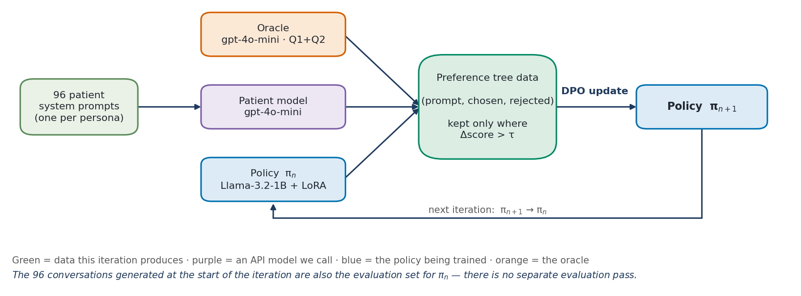
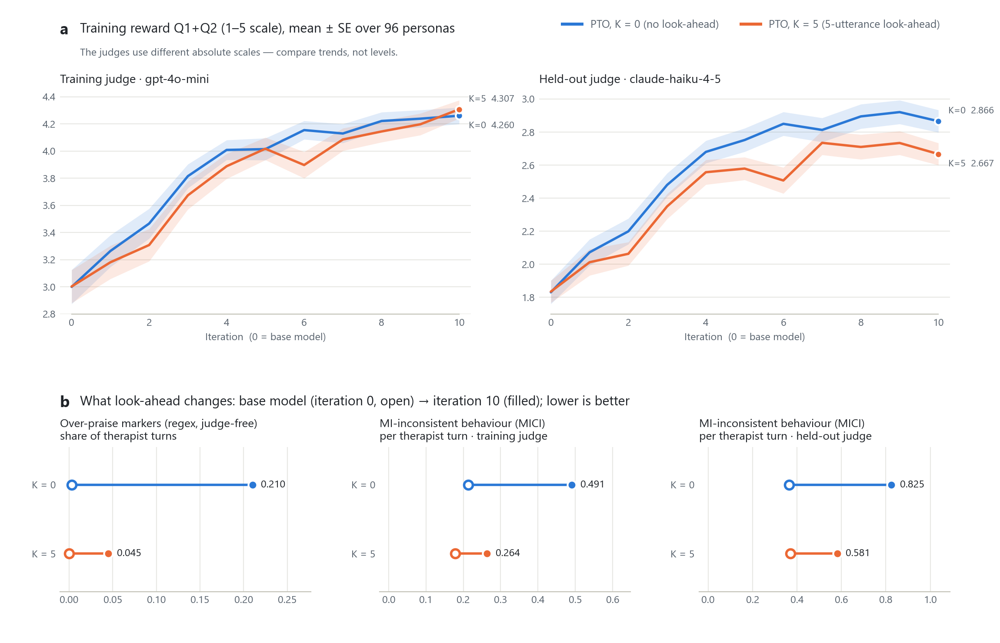
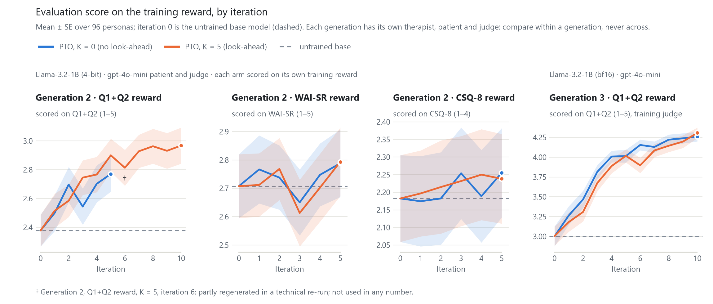
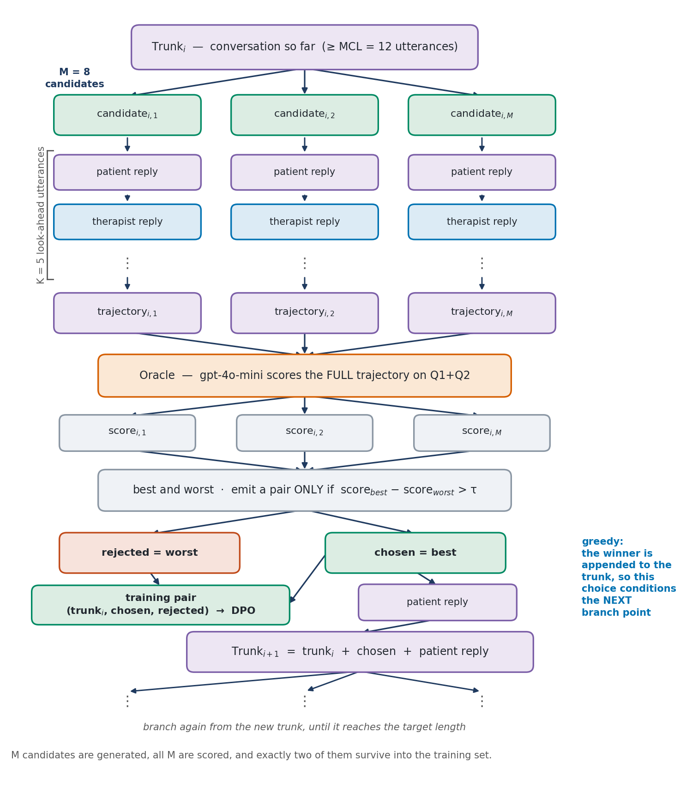

# Preference Tree Optimization (PTO)

**Self-improving dialogue agents: a small LLM learns to hold better multi-turn conversations by
exploring trees of candidate replies, simulating where each one leads, and training on its own
best-vs-worst choices with DPO.**

[](https://arxiv.org/abs/2608.12062)
[](https://sites.google.com/berkeley.edu/selfimprovingfoundationmodels/home)
[](LICENSE)
[](pyproject.toml)
[](https://github.com/Lior-Baruch/preference-tree-optimization/actions/workflows/ci.yml)

PTO trains a therapist model for **motivational interviewing** (MI) against an LLM-simulated
patient. At each turn the policy proposes several replies, optionally rolls each one forward a few
turns (**look-ahead**), an LLM oracle scores the resulting conversations, and the best and worst
replies become a DPO preference pair. Repeating this every iteration lets the model improve
without human labels. This repository is a clean, tested implementation of the method from our
ICLR 2025 SSI-FM workshop paper ([arXiv 2608.12062](https://arxiv.org/abs/2608.12062)),
developed as part of Lior Baruch's M.Sc. thesis at Reichman University.



## TL;DR results

Llama-3.2-1B + LoRA, gpt-4o-mini as patient and oracle, 96 patient personas, 10 iterations, one
run per configuration. Scores are means over the 96 personas; iteration 0 is the base model.

<picture>
  <source media="(prefers-color-scheme: dark)" srcset="results/figures/results_dark.png">
  
</picture>

| Instrument (training judge, gpt-4o-mini) | PTO K=0: iter 0 → 10 | PTO K=5: iter 0 → 10 | K=5 − K=0 at iter 10 (Holm p) |
|---|---|---|---|
| **Q1+Q2** (training reward, 1–5) | 3.000 → **4.260** | 3.003 → **4.307** | +0.047 (.608) |
| WAI-SR (working alliance) | 2.845 → 3.497 | 2.819 → 3.536 | +0.038 (1.000) |
| CSQ-8 (client satisfaction, 1–4) | 2.384 → 2.945 | 2.339 → 2.953 | +0.008 (1.000) |
| MI-SAT (MI satisfaction) | 2.837 → 3.653 | 2.839 → 3.710 | +0.057 (.608) |
| MITI (MI treatment integrity) | 3.133 → 4.273 | 3.148 → 4.258 | −0.016 (1.000) |
| PCT (patient change talk, 0–1) | 0.493 → 0.615 | 0.497 → 0.676 | **+0.061 (.009)** |
| MICI ↓ (MI-inconsistent behaviour) | 0.213 → 0.491 | 0.178 → 0.264 | **−0.228 (<.001)** |
| Q1+Q2, **held-out judge** (claude-haiku-4-5) | 1.830 → 2.866 | 1.834 → 2.667 | −0.199 (.129) |

- **PTO works.** Both arms improve over their base model on every satisfaction, alliance,
  MI-integrity and change-talk instrument, under both judges (persona-paired Wilcoxon, n = 96,
  Holm-corrected p < .001, across the nine instruments within each judge and arm). On the
  training reward Q1+Q2: +1.259 (d_z = 1.43) for K=0 and
  +1.303 (d_z = 1.35) for K=5; under the held-out judge +1.036 (d_z = 1.65) and +0.833
  (d_z = 1.12).
- **Look-ahead changes *how* the policy improves, not how much.** At iteration 10 the two arms
  tie on the reward: Q1+Q2 differs by +0.047 under the training judge and −0.199 under the
  held-out judge, neither significant after Holm correction.
  - *Where K=5 is better:* far less over-praise (share of therapist turns with effusive praise,
    a judge-free regex: .003 → .210 for K=0, only .000 → .045 for K=5), less MI-inconsistent
    behaviour (MICI −0.228 / −0.245, d_z ≈ −0.7 under both judges, Holm p < .001) and more
    patient change talk (PCT +0.061 / +0.066, Holm p ≈ .01).
  - *Where it is not:* the held-out judge rates K=5 lower on MI integrity (MITI −0.203,
    d_z = −0.49) and alliance (Q2 −0.363, d_z = −0.65), both Holm p < .001, and lower on Q1+Q2
    at iterations 5, 6 and 8. The judges disagree on whether look-ahead improves MI integrity.
  - *Single seed:* the MICI gap is an endpoint contrast. At iteration 4, K=5 was the more
    MI-inconsistent arm under both judges; the gap opens because K=0's MICI climbs after
    iteration 6.
- **Caveat.** MICI also rises versus the base model, in *both* arms (training judge: +0.278 for
  K=0, +0.086 for K=5). Optimizing an LLM-judge reward invites praise-heavy reward hacking;
  look-ahead dampens it but does not remove it.
- **Cost.** Look-ahead is not free: 8.1 vs 19.7 GPU-hours for 10 iterations on a Colab A100
  (2.4×), and 117,209 vs 301,440 API calls (2.6×).

All numbers come from the CSVs in [`results/`](results/README.md), which documents each table,
the judges and the statistics.

## Earlier experiments

The results above are the third generation of PTO experiments, and the code in this repository
is the generation-3 implementation. Generation 1 is the published paper; its results are
reported there. Generation 2 was run with earlier research code, and its numbers were recomputed
here from the raw per-conversation score files. Each generation uses a different therapist
model, patient simulator and judge, so **absolute scores are not comparable across
generations**: compare K = 0 with K = 5, or a model with its own base, within one generation
only.

| Generation | Setup | Compared | Q1+Q2 (1–5): base → trained |
|---|---|---|---|
| **1 · the paper** (ICLR 2025 SSI-FM) | Llama-2-7B 4-bit; GPT-3.5 patient and judge; 2 candidates/turn; 7 iterations | K = 0 vs K = 5 | reported in the [paper](https://arxiv.org/abs/2608.12062) |
| **2 · reward oracles** | Llama-3.2-1B 4-bit; gpt-4o-mini; 2 candidates/turn; 5 iterations (10 for one arm) | Q1+Q2 vs WAI-SR vs CSQ-8 reward, each at K = 0 and 5 | 2.378 → 2.968 (Q1+Q2 reward, K=5, iter. 10); WAI-SR and CSQ-8: no significant gain |
| **3 · this repo** | Llama-3.2-1B bf16; gpt-4o-mini + held-out claude-haiku-4-5; 8 candidates/turn; 10 iterations | K = 0 vs K = 5, 9 instruments, 2 judges | 3.000 → 4.260 (K=0), 3.003 → 4.307 (K=5) |

<picture>
  <source media="(prefers-color-scheme: dark)" srcset="results/figures/history_dark.png">
  
</picture>

- **With the Q1+Q2 reward, PTO beats the untrained base in generations 2 and 3.** In
  generation 2, both Q1+Q2-reward arms already beat the base at iteration 5, the budget the
  other oracles got (+0.39 for K=0, +0.52 for K=5, Holm p ≤ .003). The K=5 arm, continued to
  iteration 10, gains +0.590 (d_z = 0.56) and also beats the base on all four non-reward
  instruments (WAI-SR, CSQ-8, MI-SAT, MITI; Holm p ≤ .003).
- **The choice of reward oracle matters (generation 2).** Training on WAI-SR or CSQ-8 did not
  measurably improve even the instrument being optimized (+0.06 to +0.09), and no instrument
  improved significantly after Holm correction (all p ≥ .097). These oracles gave both candidate
  replies the same score at 31–73% of branch points, versus 5–10% for Q1+Q2, so fewer candidate
  pairs differed by enough (more than τ = 0.1) to become training pairs: 46–59% of the Q1+Q2
  count at K = 0 and 62–79% at K = 5. This fits the weak results but does not prove it caused
  them.
- **Look-ahead did not raise the training reward in generations 2 and 3.**
  - *Generation 2:* no matched-iteration Q1+Q2 contrast survives Holm correction. Pooled over
    iterations 1–5 for the Q1+Q2 reward, the gap is +0.060 (p = .14), but K=5 scored higher on
    WAI-SR (+0.11, Holm p = .002) and MITI (+0.11, Holm p = .04).
  - *Generation 3:* the two arms tie on the reward; K=5 shows less over-praise and
    MI-inconsistent behaviour, but the held-out judge rates its MI integrity lower (see above).
- **Caveats.** Each configuration was run once, and checkpoints were scored on the same 96
  personas they were compared on, so the table avoids "best iteration" numbers. The
  generation-2 iteration-6 point of the Q1+Q2-reward K=5 arm (†) was partly regenerated in a
  technical re-run; no number above uses it. Details:
  [`results/README.md`](results/README.md#earlier-generations).

## How it works



Each iteration *n*:

1. **Generate.** The current policy π<sub>n</sub> talks to the simulated patient once per persona
   (96 conversations of up to 50 utterances: the opening line plus 49). These conversations are
   also the evaluation set for π<sub>n</sub>.
2. **Seed.** The first MCL = 12 utterances of each conversation become the trunk of a tree.
3. **Branch.** At every therapist turn the policy samples M = 8 candidate replies.
4. **Look ahead.** Each candidate is extended by K simulated utterances (patient, therapist, ...)
   so the oracle can see its consequences (K = 0 scores the reply in place).
5. **Score and filter.** The oracle (gpt-4o-mini) rates every extended conversation on the Q1+Q2
   questionnaires. If best − worst > τ = 0.1, (prompt, best, worst) becomes a DPO pair. The best
   reply is appended to the trunk, the patient answers, and branching continues until the trunk
   reaches 49 utterances.
6. **Update.** DPO (β = 0.1) on all pairs of the iteration trains the LoRA adapter, giving
   π<sub>n+1</sub>.

[`docs/method.md`](docs/method.md) covers the details: greedy vs independent trees, why MCL
exists, the iteration-to-model-state mapping, and how this implementation differs from the
research code.

## Quickstart

```bash
git clone https://github.com/Lior-Baruch/preference-tree-optimization.git
cd preference-tree-optimization

# PyTorch first: pick the build for your hardware (https://pytorch.org/get-started/locally/).
# CPU only (tests, dry runs):
pip install torch --index-url https://download.pytorch.org/whl/cpu

pip install -e ".[train,eval,tracking]"  # tracking: TensorBoard/W&B (the configs log to TensorBoard); add ,dev for tests
```

```bash
export OPENAI_API_KEY=...      # patient simulator + training oracle (required)
export HF_TOKEN=...            # Llama 3.2 is gated on the Hugging Face Hub
export ANTHROPIC_API_KEY=...   # optional: held-out judge for `pto evaluate`
```

```bash
# Validate a config and print the resolved run directory (no model, no API calls)
pto train --config configs/pto_k5.yaml --dry-run

# Smoke run: 2 iterations x 4 short conversations, to check the setup end to end
pto train --config configs/quicktest.yaml

# The two reported runs (a CUDA GPU is needed; see docs/reproducing.md)
pto train --config configs/pto_k0.yaml
pto train --config configs/pto_k5.yaml
```

A run writes everything under `runs/<run_name>/` and resumes automatically if restarted.
Conversations of model state *n* land in `runs/<run_name>/conversations/model_iter_<n>/`, with a
`manifest.json` that maps each file to its persona.

```bash
RUN=runs/pto_Q1Q2_Llama32-1B_K5_MCL12_M8_greedy

# Fresh conversations from any adapter (or `--adapter base`)
pto generate --config configs/pto_k5.yaml --adapter $RUN/iteration_10/adapter --out convs/k5_iter10

# Score conversations with an LLM judge (resumable, tidy CSV)
pto evaluate --conversations $RUN/conversations/model_iter_10 \
    --judge openai:gpt-4o-mini-2024-07-18 --out scores_k5.csv
pto evaluate --conversations $RUN/conversations/model_iter_10 \
    --judge anthropic:claude-haiku-4-5 --out scores_k5_haiku.csv

# The K=0 run, scored the same way, for the comparison below
RUN0=runs/pto_Q1Q2_Llama32-1B_K0_MCL12_M8_greedy
pto evaluate --conversations $RUN0/conversations/model_iter_10 \
    --judge openai:gpt-4o-mini-2024-07-18 --out scores_k0.csv

# Persona-paired comparison: mean A/B, delta, Cohen's d_z, bootstrap CI, Wilcoxon + Holm
pto compare scores_k0.csv scores_k5.csv --out k5_vs_k0.md
```

Every YAML key is documented in [`docs/configuration.md`](docs/configuration.md);
[`docs/reproducing.md`](docs/reproducing.md) lists hardware, cost drivers and practical gotchas.

**Colab.** [`notebooks/train_colab.ipynb`](notebooks/train_colab.ipynb) installs the package,
reads keys from Colab secrets and runs training and evaluation:
[open in Colab](https://colab.research.google.com/github/Lior-Baruch/preference-tree-optimization/blob/main/notebooks/train_colab.ipynb).

## Pretrained adapters

The LoRA adapters of the two reported runs are on the Hugging Face Hub. `main` holds iteration 10;
every earlier iteration is a separate commit in the repo's commit history (titled
`iteration_<n>/…`), so an earlier policy loads by passing that commit's SHA as `revision=` to
`PeftModel.from_pretrained`.

| Run | Adapter |
|---|---|
| PTO, K = 0 | [LBK95/PTO_Iterative_Q1Q2_Llama32-1B_LA0_MCL12_M8_PTgreedy_full](https://huggingface.co/LBK95/PTO_Iterative_Q1Q2_Llama32-1B_LA0_MCL12_M8_PTgreedy_full) |
| PTO, K = 5 | [LBK95/PTO_Iterative_Q1Q2_Llama32-1B_LA5_MCL12_M8_PTgreedy_full](https://huggingface.co/LBK95/PTO_Iterative_Q1Q2_Llama32-1B_LA5_MCL12_M8_PTgreedy_full) |

```python
import pto._compat  # noqa: F401  -- load trl before torch (see docs/reproducing.md)
from peft import PeftModel
from pto.model import load_base_model, patch_generate, setup_tokenizer

tokenizer = setup_tokenizer("meta-llama/Llama-3.2-1B")      # base tokenizer + ChatML template
base = load_base_model("meta-llama/Llama-3.2-1B")
policy = PeftModel.from_pretrained(
    base, "LBK95/PTO_Iterative_Q1Q2_Llama32-1B_LA5_MCL12_M8_PTgreedy_full"
)
patch_generate(policy, tokenizer)  # generate() needs the tokenizer for the ChatML stop strings

from pto.conversation import turns_to_messages
from pto.generation import generate_therapist_responses_batch
from pto.personas import get_therapist_prompts

system_prompt, opening = get_therapist_prompts()
messages = turns_to_messages(
    [{"role": "therapist", "content": opening},
     {"role": "patient", "content": "I want to quit smoking, but I keep failing."}],
    system_prompt,
)
# Uses the ChatML stop strings by default and strips any marker residue from the reply.
replies, _ = generate_therapist_responses_batch(
    policy, tokenizer, [messages], max_tokens=200, temperature=0.9
)
print(replies[0])
```

## Repository layout

```
configs/            pto_k0.yaml, pto_k5.yaml (the reported runs), quicktest.yaml
src/pto/
  cli.py            pto train | generate | evaluate | compare
  config.py         YAML schema as dataclasses, validation, run naming
  trainer.py        the iteration loop: generate -> build trees -> DPO -> save (resumable)
  tree.py           greedy and independent preference-tree builders, tau filter, pairs.csv
  lookahead.py      batched K-utterance look-ahead simulation
  oracle.py         questionnaire scoring with strict JSON schemas
  generation.py     batched policy-vs-patient conversation generation
  conversation.py   conversation state, ChatML handling, prompt truncation
  model.py          tokenizer, base model, LoRA, checkpoint discovery
  personas.py       the 96 patient personas and the therapist prompt
  questionnaires.py Q1, Q2, WAI-SR, CSQ-8, MI-SAT, MITI, MICI, MIPROC prompts and schemas
  evaluation/       judges (OpenAI, Anthropic), scoring, paired statistics
  tracking.py       optional TensorBoard / W&B logging
tests/              offline tests (fake API client, tiny CPU model), incl. an end-to-end run
results/            reported numbers (CSV) and figures, with provenance
scripts/            regenerate the figures from results/data
docs/               method, configuration reference, reproduction notes
notebooks/          Colab notebook
```

## Limitations

- **One run per configuration.** The K=0 vs K=5 comparison rests on a single seed each; the
  persona-paired tests capture conversation-level noise, not run-to-run variance.
- **No held-out personas.** Every iteration is scored on the same 96 personas used to compare
  checkpoints, so a "best iteration" would be optimistic; the README quotes final iterations or
  checkpoint averages.
- **Simulated patients.** Every patient is gpt-4o-mini following a persona prompt; real clients
  behave differently.
- **LLM judges, no human evaluation.** Training and evaluation both rely on LLM judges. A second,
  held-out judge (claude-haiku-4-5) guards against overfitting the training oracle, but it is
  still an LLM, and its absolute scale differs from the training judge's.
- **Correlated instruments.** The questionnaires largely move together, so "every instrument
  improves" is weaker evidence of distinct skills than it sounds; MICI and PCT are the most
  informative checks.

## Acknowledgements

Co-authors Moshe Butman, Kfir Bar and Doron Friedman; Reichman University. The Q1/Q2
questionnaires and the patient-simulator design come from Yosef et al. (2024),
[*Assessing Motivational Interviewing Sessions with AI-Generated Patient Simulations*](https://aclanthology.org/2024.clpsych-1.1/),
CLPsych 2024.

## Citation

```bibtex
@inproceedings{baruch2025pto,
  author        = {Baruch, Lior and Butman, Moshe and Bar, Kfir and Friedman, Doron},
  title         = {Preference Tree Optimization: Enhancing Goal-Oriented Dialogue with
                   Look-Ahead Simulations},
  booktitle     = {ICLR 2025 Workshop on Scaling Self-Improving Foundation Models
                   without Human Supervision (SSI-FM)},
  year          = {2025},
  eprint        = {2608.12062},
  archivePrefix = {arXiv},
  primaryClass  = {cs.CL},
  url           = {https://arxiv.org/abs/2608.12062}
}
```

Released under the [MIT License](LICENSE).
